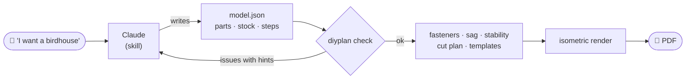

<div align="center">

# diy-instructions

**Describe a woodworking project in plain words, get a flat-pack-style assembly manual that actually adds up.**

[](https://github.com/__REPO__/actions/workflows/ci.yml)


**English** · [Русский](README.ru.md)


</div>

`diy-instructions` is a **Claude skill** plus a Python engine, **`diyplan`**. You tell Claude
*"I want a birdhouse from 20 mm boards"*; Claude asks a couple of questions, designs the build, and
hands you a PDF with:

- dimensioned part drawings and a cut plan;
- a shopping list, screws included;
- isometric pictures for every step, showing where each part goes and where every screw enters;
- 1:1 print templates for shaped cuts;
- a rough strength and stability check.

## Why not just ask an image model?

Generated "IKEA-style" pictures look convincing, but the parts don't fit and the dimensions don't
add up. In this project the LLM only **designs**: it writes a JSON model of the parts. Everything
after that is deterministic code, so every number in the PDF comes from the same geometry.



## Features

| | |
|---|---|
| **Geometry** | Each part is a blank cut from a board or sheet. Supports straight cuts (gables, trapezoids), tilt (roof slopes), bevel planes and `snap`, which slides a part until it touches others, so the LLM never does trigonometry. Collisions, floating parts, near-misses and edge-only contacts are found with the separating-axis theorem. |
| **Fasteners** | Screws placed automatically: length ≈ 2.5× the thickness, edge distances respected, no screws meeting inside a part, none hitting a hole or poking through. Confirmat screws are used for chipboard/MDF edges. |
| **Strength** | Shelf sag from the beam formula, using the material's stiffness, long-term creep, and the actual supports (end uprights, middle dividers, back rails). Also a tip-over check. Loads are printed in the PDF. |
| **Cutting** | Boards are packed First Fit Decreasing, picking the cheapest board length. Sheets use MaxRects with rotation or fixed grain. Hints like *"shorten each part by 2 mm and you need one board less"* and *"an offcut of 650×1800 is enough"*. Material cost appears when prices are given. |
| **Steps** | The new part is highlighted, with an arrow along a collision-free path. Position dimensions are drawn on the picture (*"shelf: 262 mm up from the bottom of A"*), and a zoom callout appears for each fastener type. Parts in the way turn translucent. Screws driven from the hidden side show as hollow marks. Sub-assemblies are built on the bench, then attached. |
| **Templates** | 1:1 print pages only where marking is genuinely hard: shaped cuts and large openings. Each is anchored to a part edge, tiled across sheets when needed, with a 100 mm ruler check. |
| **Safety** | Flags for load-bearing, children, outdoor and wall-mounted builds, a safety page and a disclaimer. The skill refuses life-critical builds such as ladders, swings, bunk beds and railings. |
| **Locale** | English and Russian. Millimetres or inches, with fractions to 1/16″ and US screw sizes (`#8 × 2″`). |

## Gallery

<table>
<tr>
<td width="50%"><br><sub><b>Steps.</b> Position dimensions, zoom callout, ghosted parts, inches.</sub></td>
<td width="50%"><br><sub><b>Chipboard.</b> Confirmat screws, a support rail against shelf sag.</sub></td>
</tr>
<tr>
<td><br><sub><b>Parts.</b> Real outlines, cut points, bevels, openings.</sub></td>
<td><br><sub><b>Cut plan.</b> Sheet packing, labels for thin strips, offcut hint.</sub></td>
</tr>
<tr>
<td><br><sub><b>1:1 template.</b> Anchored to the part edge, with a ruler check.</sub></td>
<td><br><sub><b>Safety.</b> Tips, safety flags, design loads, stability.</sub></td>
</tr>
</table>

## Quick start

```bash
git clone https://github.com/__REPO__.git
cd diy-instructions
pip install -e .

diyplan check   examples/birdhouse.json            # validate, list what to buy
diyplan build   examples/birdhouse.json -o out.pdf
diyplan preview examples/workbench-in.json -o preview/   # PDF + PNG of every page
diyplan check   examples/stool.json --json         # machine-readable, for the LLM loop
```

Everything is offline, and the only dependency is `reportlab`. A Cyrillic-capable font (DejaVu) is
bundled. PNG previews need `pdftoppm` (poppler).

## Using it as a Claude skill

1. Put this folder where your Claude skills live, or upload it as a skill.
2. Ask for something to build: *"a shoe rack from 16 mm chipboard, 60 cm wide"*.
3. Claude follows [`SKILL.md`](SKILL.md) through these steps:
   - checks the safety gate;
   - asks a couple of questions;
   - writes the model;
   - loops on `diyplan check --json` until it passes;
   - looks at the rendered pages;
   - hands you the PDF.

The model format is documented in [`references/model-format.md`](references/model-format.md), and
typical constructions (boxes, carcasses, shelves, stools, roofs, frames) in
[`references/recipes.md`](references/recipes.md).

A minimal model:

```jsonc
{
  "title": "Birdhouse", "lang": "en", "units": "mm", "safety": ["outdoor"],
  "stock": [{"id": "b20", "kind": "board", "name": "Pine board", "thickness": 20, "width": 200, "length": 2000}],
  "parts": [
    {"id": "floor", "name": "Floor", "stock": "b20", "size": [140, 140, 20], "origin": [20, 20, 0]},
    {"id": "side",  "name": "Side",  "stock": "b20", "size": [20, 140, 330], "origin": [0, 20, 0]}
    // …walls, then a roof: "rotate": {"axis": "x", "rise": -40, "run": 180}, "snap": {"to": [...]}
  ],
  "steps": [{"title": "Floor and side", "add": ["floor", "side"], "glue": true}]
}
```

## Examples

| model | what it shows |
|---|---|
| [`birdhouse.json`](examples/birdhouse.json) · [PDF](examples/birdhouse.pdf) | single-slope removable roof: `trim`, `rotate`, `snap` |
| [`titmouse-house.json`](examples/titmouse-house.json) · [PDF](examples/titmouse-house.pdf) | 45° gable roof, the short slope slides up to the ridge |
| [`wall-shelf.json`](examples/wall-shelf.json) · [PDF](examples/wall-shelf.pdf) | wall shelf: load, wall-mount hardware |
| [`stool.json`](examples/stool.json) · [PDF](examples/stool.pdf) | plywood stool: point load on the seat, sheet sizes with prices |
| [`shoe-rack.json`](examples/shoe-rack.json) · [PDF](examples/shoe-rack.pdf) | chipboard: confirmat screws, anti-sag rail, `fasten_to` |
| [`workbench-in.json`](examples/workbench-in.json) · [PDF](examples/workbench-in.pdf) | inches, end frames built as sub-assemblies, mirrored frame |

## How it was tested

Besides 96 unit tests, the skill was run by Claude agents acting as real users on **19 requests**
in two rounds: bookshelf, toolbox, raised beds (metric and imperial), bench, doghouse, feeder,
shoe rack, stool, coat rack, nightstand, seedling box, cat house, TV stand, workbench, kids'
bookcase, and a bunk-bed request that is correctly refused. Their models live in
[`tests/fixtures/`](tests/fixtures) as a regression corpus: every engine change must keep them
valid and renderable.

## Project layout

```
diyplan/
  geom.py       convex polyhedra, separating-axis tests, sweep-to-contact (no dependencies)
  model.py      parts, contacts, validation, fasteners, sub-assemblies
  structure.py  sag and stability
  cutlist.py    board/sheet packing, shopping list, hints
  iso.py        isometric renderer, zoom callouts, dimension lines
  pdf.py        PDF layout, 1:1 templates
  i18n.py       ru/en strings, mm/inch formatting
SKILL.md        instructions for Claude
references/     model format and construction recipes
examples/       models and generated PDFs
tests/          pytest + regression models written by Claude
```

## Limits

- Parts are convex: no grooves, tenons or notches at an edge. Build L-shapes from two parts.
- No moving doors or drawers. Hinges and slides go into the shopping list and text only.
- Strength is an engineering estimate, not a code-compliant calculation. The PDF says so.

## Roadmap

- Non-convex parts (dados, tenons, notches)
- Doors, drawers, hinges
- Web version: the same JSON rendered to SVG in the browser

## Development

```bash
pip install -e ".[dev]"
pytest -q
```

## License

MIT. The bundled DejaVu fonts are under the Bitstream Vera / DejaVu license
([`diyplan/fonts/LICENSE-DejaVu.txt`](diyplan/fonts/LICENSE-DejaVu.txt)).
