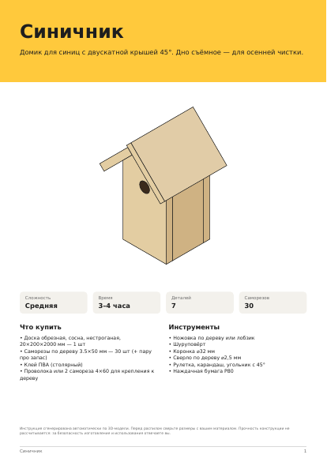

# diy-instructions

Скилл для Claude и Python-движок `diyplan`: пишешь «хочу скворечник из доски 20 мм» — получаешь
PDF-инструкцию в духе инструкций к мебели. В ней чертежи деталей с размерами, раскрой и список
покупок, картинки на каждый шаг с размерами положения и местами саморезов, шаблоны 1:1 для печати
и прикидка прочности.

*English below.*



## Почему не просто попросить нейросеть нарисовать

Сгенерированные картинки выглядят убедительно, но размеры в них не сходятся. Здесь LLM только
**проектирует**: пишет JSON-модель из деталей-заготовок. Всё остальное делает детерминированный код:

```
диалог с Claude ──► model.json ──► check ──► крепёж, прочность, раскрой ──► изометрия ──► PDF
                    (LLM)          (код)      (код)                          (код)
```

**Геометрия**
- Деталь — заготовка из доски или листа. К ней применяются резы (фронтон, трапеция), наклон
  (скат крыши), скос плоскостью и `snap`, который двигает деталь до касания, чтобы LLM не считала синусы.
- Проверки построены на теореме о разделяющей оси. Они ловят пересечения, детали «в воздухе»,
  подозрительные зазоры, касание только по ребру, проёмы у края и проёмы, закрытые соседней деталью.

**Крепёж**
- Длина самореза ≈ 2,5 толщины, плюс отступы от края.
- Встречные саморезы не сталкиваются, в отверстия не попадают и насквозь не выходят.
- В кромку ЛДСП и МДФ ставится конфирмат.

**Прочность**
- Прогиб полок считается по формуле балки, модуль упругости зависит от материала, учтена
  ползучесть ЛДСП.
- Отдельно проверяется устойчивость на опрокидывание.

**Раскрой**
- Доски раскладываются методом FFD с выбором самой выгодной длины, листы — методом MaxRects.
- Есть подсказки вида «укоротите на 2 мм — хватит одной доски меньше» и «хватит куска 650×1800».
- Если указаны цены, считается бюджет материалов.

**Шаги**
- Новая деталь подсвечена, стрелка показывает свободный путь, которым её подводить.
- Размеры положения рисуются прямо на картинке («полка — 262 мм от низа боковины»).
- На первом узле каждого типа крепежа есть лупа.
- Детали, которые загораживают новую, становятся полупрозрачными, а саморезы с обратной стороны
  рисуются пустыми кружками.
- Узлы можно собрать отдельно на столе и затем поставить целиком.

**Шаблоны 1:1** печатаются только там, где реально нужна разметка, привязаны к краю детали
и снабжены контрольным отрезком 100 мм.

**Язык и единицы**: русский и английский, миллиметры и дюймы (дроби до 1/16″, саморезы `#8 × 2″`).

## Быстрый старт

```bash
pip install -e .
diyplan check examples/birdhouse.json
diyplan build examples/birdhouse.json -o birdhouse.pdf
diyplan preview examples/stool.json -o preview/     # PDF + PNG всех страниц
```

Примеры в `examples/`:

| модель | что показывает |
|---|---|
| `birdhouse.json` | односкатная съёмная крыша: `trim`, `rotate`, `snap` |
| `titmouse-house.json` | двускатная крыша 45°, `snap` вдоль ската к коньку |
| `wall-shelf.json` | настенная полка, нагрузка, точки крепления к стене |
| `stool.json` | табурет из фанеры, точечная нагрузка на сиденье, цены и выбор формата листа |
| `shoe-rack.json` | обувница из ЛДСП: конфирматы, царга против прогиба, `fasten_to` |

Шрифт DejaVu лежит в пакете. Подменить его можно через `DIYPLAN_FONT` и `DIYPLAN_FONT_BOLD`.

## Как скилл

Положите папку в каталог скиллов Claude (или загрузите zip как skill). Инструкция для модели
лежит в [SKILL.md](SKILL.md), полный формат — в [references/model-format.md](references/model-format.md),
типовые конструкции — в [references/recipes.md](references/recipes.md).

Скилл не делает инструкций для конструкций, от прочности которых зависит жизнь: лестниц, качелей,
двухъярусных кроватей, перил. Движок проверяет геометрию, а прочность только прикидывает.

## Разработка

```bash
pip install -e ".[dev]"
pytest -q
```

`tests/fixtures/` — 13 моделей, которые Claude написал по реальным запросам во время прогона скилла.
Они служат регрессией: правки движка не должны их ломать.

## Структура

```
diyplan/
  geom.py       выпуклые многогранники, SAT, сдвиг до касания (без зависимостей)
  model.py      детали, контакты, проверки, крепёж, узлы
  structure.py  прогиб и устойчивость
  cutlist.py    раскрой досок и листов, закупка, подсказки
  iso.py        изометрический рендер, лупы, размерные линии
  pdf.py        вёрстка PDF, шаблоны 1:1
  i18n.py       строки ru/en, мм/дюймы
examples/       модели и готовые PDF
references/     формат модели и рецепты для скилла
tests/          pytest + регрессионные модели
```

## Что дальше

- Невыпуклые детали: пазы, шипы, Г-образные вырезы.
- Петли, двери и ящики.
- Веб-версия: тот же JSON → SVG в браузере.

---

## English

`diyplan` turns a JSON model of a woodworking project (boards, plywood, OSB, chipboard) into a
validated, illustrated assembly PDF. The PDF contains dimensioned part drawings, a cut plan and
shopping list, isometric steps with position dimensions and screw locations, 1:1 print templates
and a rough sag/stability check. The bundled Claude skill (`SKILL.md`) lets Claude design the
model from a conversation; all geometry, fastening, cutting and drawing is done by code, so the
dimensions add up. Supports metric and imperial (fractions, `#8 × 2″` screws), Russian and English.

```bash
pip install -e .
diyplan preview examples/stool.json -o preview/
```

## License

MIT. Bundled DejaVu fonts: Bitstream Vera / DejaVu license (`diyplan/fonts/LICENSE-DejaVu.txt`).
