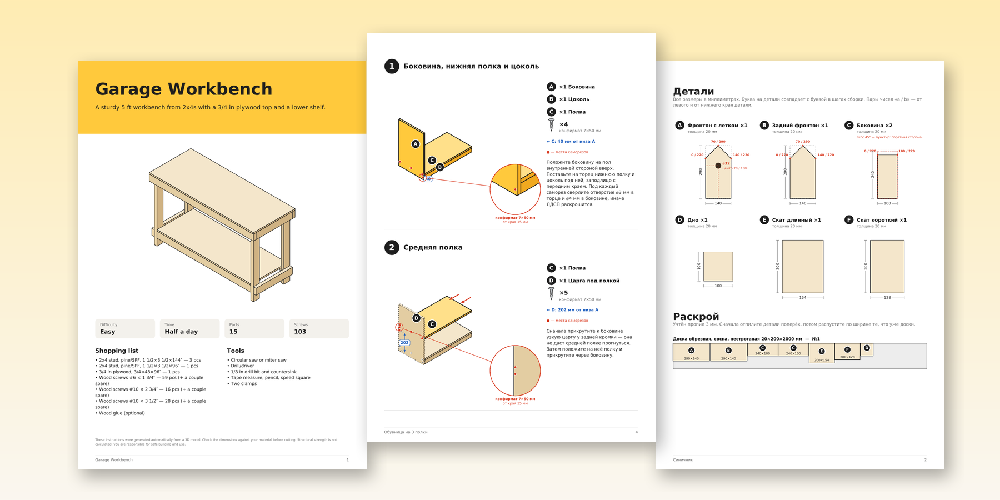
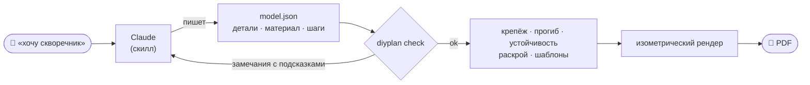
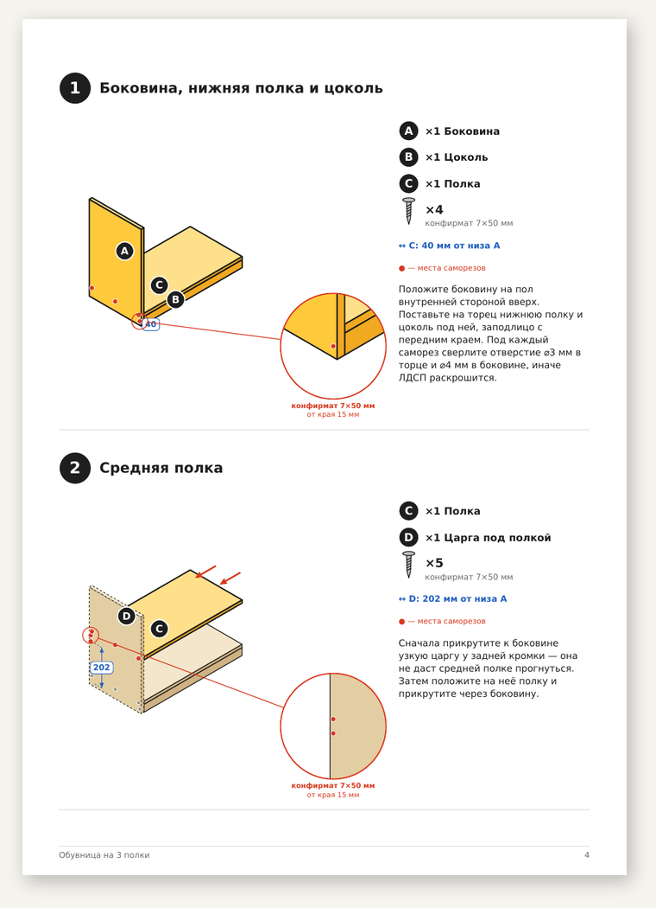
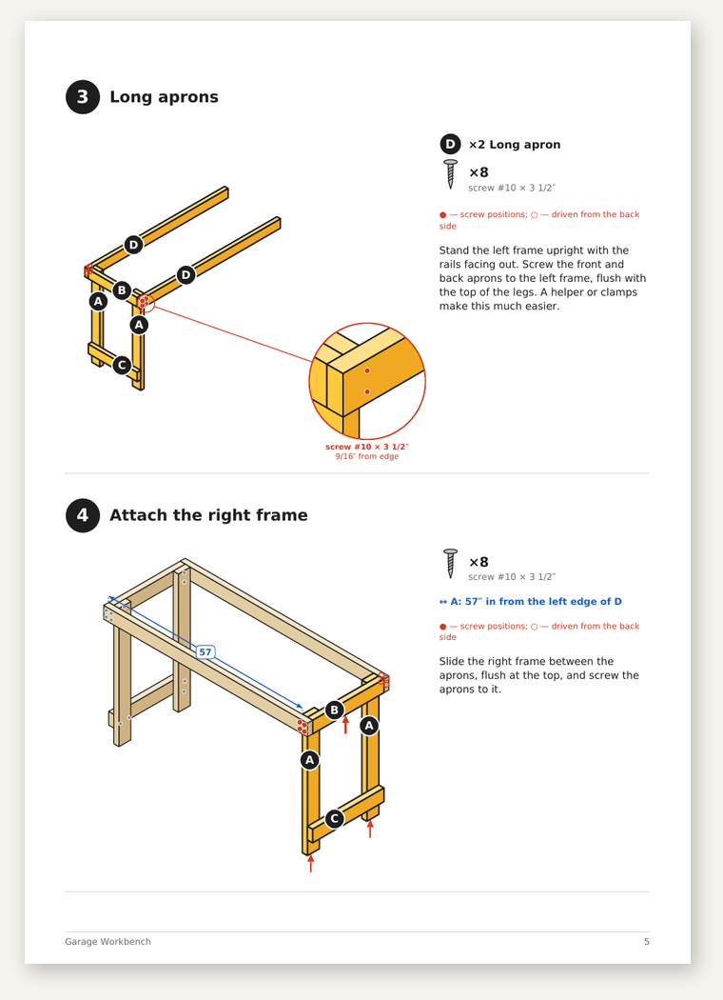
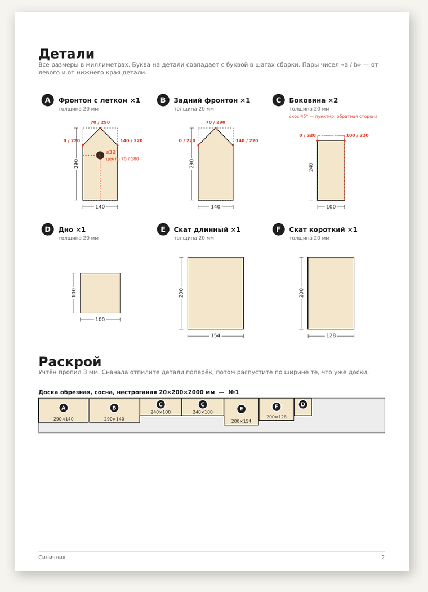
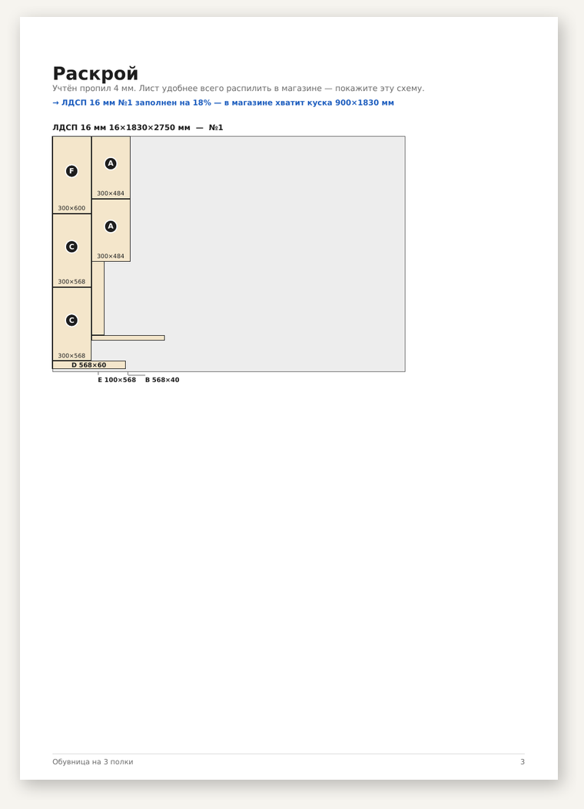
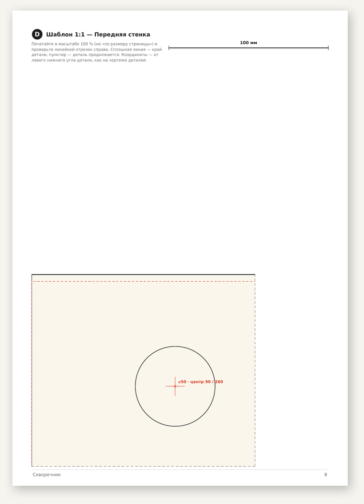
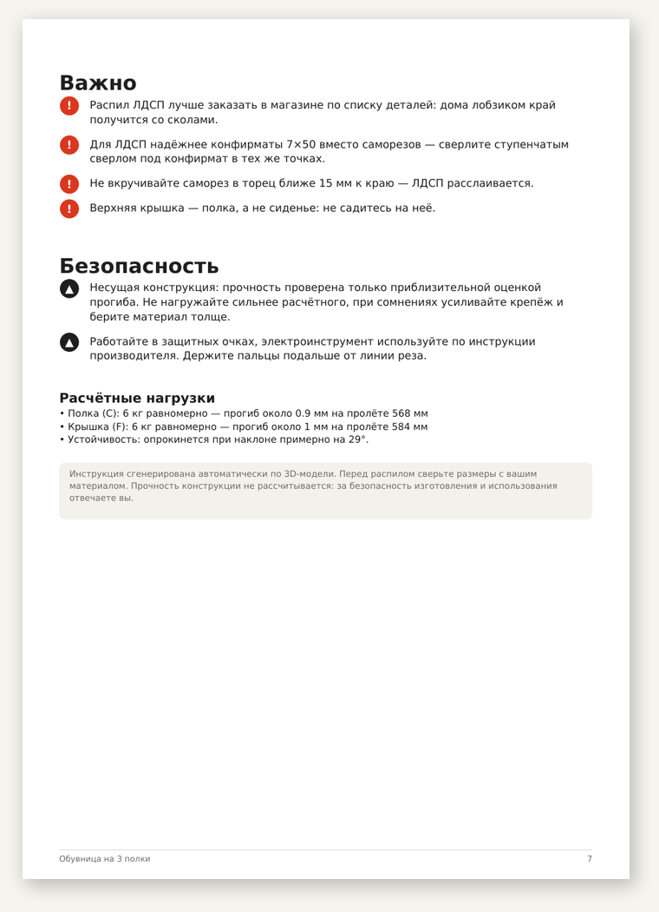

<div align="center">

# diy-instructions

**Опишите поделку словами — получите инструкцию в духе мебельных, в которой все размеры сходятся.**

[](https://github.com/__REPO__/actions/workflows/ci.yml)


[English](README.md) · **Русский**



</div>

`diy-instructions` — это **скилл для Claude** и Python-движок **`diyplan`**. Вы пишете
*«хочу скворечник из доски 20 мм»*. Claude задаёт пару вопросов, проектирует изделие и отдаёт
PDF, в котором есть:
- чертежи деталей с размерами и схема раскроя;
- список покупок вместе с саморезами;
- изометрические картинки на каждый шаг: куда ставить деталь и куда входит каждый саморез;
- шаблоны 1:1 для фигурных резов;
- прикидка прочности и устойчивости.

## Почему не просто попросить нейросеть нарисовать

Сгенерированные картинки «как в IKEA» выглядят убедительно, но детали в них не стыкуются, а
размеры не сходятся. Здесь LLM только **проектирует**: пишет JSON-модель из деталей. Всё остальное
делает детерминированный код, поэтому каждое число в PDF взято из одной и той же геометрии.



## Возможности

| | |
|---|---|
| **Геометрия** | Деталь — это заготовка из доски или листа. Её можно резать прямыми резами (фронтон, трапеция), наклонять (скат крыши), срезать плоскостью и двигать `snap` до касания с соседями, так что синусы LLM не считает. Пересечения, детали «в воздухе», подозрительные зазоры и касания только по ребру ловит теорема о разделяющей оси. |
| **Крепёж** | Саморезы ставятся сами. Длина около 2,5 толщины, отступы от края соблюдены. Саморезы не встречаются внутри детали, не попадают в отверстия и не выходят насквозь. В кромку ЛДСП и МДФ ставится конфирмат. |
| **Прочность** | Прогиб полок считается по формуле балки: учитывается жёсткость материала, долговременная ползучесть и реальные опоры (боковины, средние перегородки, задние царги). Проверяется и опрокидывание. Нагрузки печатаются в PDF. |
| **Раскрой** | Доски раскладываются методом FFD с выбором самой выгодной длины. Листы — методом MaxRects с поворотом или с учётом волокон. Есть подсказки вида «укоротите на 2 мм — хватит одной доски меньше» и «хватит куска 650×1800». Если указаны цены, считается бюджет. |
| **Шаги** | Новая деталь подсвечена, стрелка показывает свободный путь, которым её подводить. Размеры положения нарисованы прямо на картинке («полка — 262 мм от низа боковины»). На первом узле каждого типа крепежа есть лупа. Детали, которые загораживают новую, становятся полупрозрачными. Саморезы с обратной стороны показаны пустыми кружками. Узлы можно собрать отдельно на столе и поставить целиком. |
| **Шаблоны** | Страницы 1:1 печатаются только там, где разметка действительно сложная: фигурные резы и крупные проёмы. Шаблон привязан к краю детали. Если он не влезает на лист, разбивается на несколько листов с перекрытием. На каждом есть контрольный отрезок 100 мм. |
| **Безопасность** | Флаги «несущая конструкция», «для детей», «для улицы», «крепится к стене», страница безопасности и дисклеймер. Для конструкций, от прочности которых зависит жизнь (лестницы, качели, двухъярусные кровати, перила), скилл отказывает. |
| **Язык и единицы** | Русский и английский. Миллиметры или дюймы: дроби до 1/16″, саморезы по американской маркировке (`#8 × 2″`). |

## Галерея

<table>
<tr>
<td width="50%"><br><sub><b>Шаги.</b> Конфирматы, размеры положения, лупа, царга против прогиба.</sub></td>
<td width="50%"><br><sub><b>Дюймы.</b> Рамы собираются отдельными узлами, полупрозрачные детали.</sub></td>
</tr>
<tr>
<td><br><sub><b>Детали.</b> Настоящий контур, точки резов, скосы, проёмы.</sub></td>
<td><br><sub><b>Раскрой.</b> Укладка листа, подписи узких полосок, подсказка про обрезок.</sub></td>
</tr>
<tr>
<td><br><sub><b>Шаблон 1:1.</b> Привязан к краю детали, есть контрольный отрезок.</sub></td>
<td><br><sub><b>Безопасность.</b> Советы, флаги, расчётные нагрузки, устойчивость.</sub></td>
</tr>
</table>

## Быстрый старт

```bash
git clone https://github.com/__REPO__.git
cd diy-instructions
pip install -e .

diyplan check   examples/birdhouse.json            # проверить модель, увидеть, что купить
diyplan build   examples/birdhouse.json -o out.pdf
diyplan preview examples/shoe-rack.json -o preview/  # PDF + PNG всех страниц
diyplan check   examples/stool.json --json         # машиночитаемый отчёт для цикла с LLM
```

Всё работает офлайн, единственная зависимость — `reportlab`. Шрифт с кириллицей (DejaVu) лежит в
пакете. Для PNG-превью нужен `pdftoppm` (poppler).

## Как использовать скилл в Claude

1. Положите эту папку в каталог скиллов Claude или загрузите её как скилл.
2. Попросите что-нибудь сделать, например: *«обувница из ЛДСП 16 мм, ширина 60 см»*.
3. Дальше Claude действует по [`SKILL.md`](SKILL.md):
   - проверяет, не опасный ли это запрос;
   - задаёт пару вопросов;
   - пишет модель;
   - гоняет `diyplan check --json`, пока проверка не пройдёт;
   - смотрит на отрисованные страницы;
   - отдаёт PDF.

Формат модели описан в [`references/model-format.md`](references/model-format.md), типовые
конструкции (короба, корпуса, полки, табуреты, крыши, рамы) — в
[`references/recipes.md`](references/recipes.md).

## Примеры

| модель | что показывает |
|---|---|
| [`birdhouse.json`](examples/birdhouse.json) · [PDF](examples/birdhouse.pdf) | скворечник с односкатной съёмной крышей: `trim`, `rotate`, `snap` |
| [`titmouse-house.json`](examples/titmouse-house.json) · [PDF](examples/titmouse-house.pdf) | синичник с двускатной крышей 45°, короткий скат доезжает до конька |
| [`wall-shelf.json`](examples/wall-shelf.json) · [PDF](examples/wall-shelf.pdf) | настенная полка: нагрузка, крепёж к стене |
| [`stool.json`](examples/stool.json) · [PDF](examples/stool.pdf) | табурет из фанеры: точечная нагрузка на сиденье, форматы листа с ценами |
| [`shoe-rack.json`](examples/shoe-rack.json) · [PDF](examples/shoe-rack.pdf) | обувница из ЛДСП: конфирматы, царга против прогиба, `fasten_to` |
| [`workbench-in.json`](examples/workbench-in.json) · [PDF](examples/workbench-in.pdf) | верстак в дюймах: рамы-узлы, зеркальная вторая рама |

## Как это тестировалось

Кроме 96 юнит-тестов, скилл в два круга прогнали агенты Claude, которые вели себя как обычные
пользователи, на **19 запросах**:
- полка для книг, ящик для инструментов, грядки (в метрической системе и в дюймах);
- скамейка, будка, кормушка, обувница, табурет, вешалка;
- тумбочка, ящик для рассады, домик для кошки, тумба под ТВ, верстак, детский стеллаж;
- двухъярусная кровать — этот запрос скилл корректно отклонил.

Написанные агентами модели лежат в [`tests/fixtures/`](tests/fixtures) как регрессия: любая правка
движка обязана оставлять их корректными и отрисовываемыми.

## Структура

```
diyplan/
  geom.py       выпуклые многогранники, SAT, сдвиг до касания (без зависимостей)
  model.py      детали, контакты, проверки, крепёж, узлы
  structure.py  прогиб и устойчивость
  cutlist.py    раскрой досок и листов, закупка, подсказки
  iso.py        изометрический рендер, лупы, размерные линии
  pdf.py        вёрстка PDF, шаблоны 1:1
  i18n.py       строки ru/en, мм/дюймы
SKILL.md        инструкция для Claude
references/     формат модели и рецепты конструкций
examples/       модели и готовые PDF
tests/          pytest + регрессионные модели, написанные Claude
```

## Ограничения

- Детали только выпуклые: пазов, шипов и выемок у края нет. Г-образную деталь собирайте из двух.
- Двери и ящики не двигаются. Петли и направляющие попадают только в список покупок и текст.
- Прочность — инженерная прикидка, а не расчёт по нормам. В PDF это сказано прямо.

## Планы

- Невыпуклые детали: пазы, шипы, выемки
- Двери, ящики, петли
- Веб-версия: тот же JSON → SVG в браузере

## Разработка

```bash
pip install -e ".[dev]"
pytest -q
```

## Лицензия

MIT. Шрифты DejaVu в пакете распространяются под лицензией Bitstream Vera / DejaVu
([`diyplan/fonts/LICENSE-DejaVu.txt`](diyplan/fonts/LICENSE-DejaVu.txt)).
